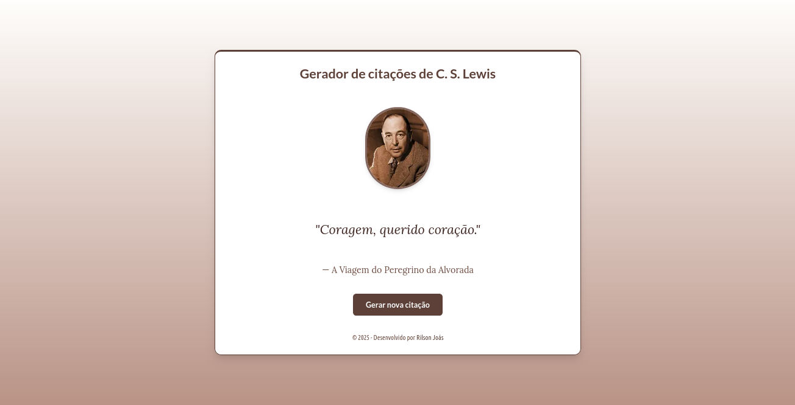

# 📜 Gerador de Citações C. S. Lewis

Este é um projeto web interativo que gera citações inspiradoras e profundas do renomado escritor e teólogo C. S. Lewis. A aplicação foi construída com tecnologias modernas, focando em uma experiência de usuário limpa, elegante e responsiva.

**🔗 Acesse a aplicação:** https://cslewis.narniano.com/

<p align="center">
  
</p>

## ✨ Visão Geral do Projeto

O objetivo deste projeto é oferecer aos usuários uma forma simples e agradável de explorar a sabedoria de C. S. Lewis. A cada clique, uma nova citação é exibida, juntamente com a fonte (o livro ou obra de origem). Além disso, a aplicação inclui links para compra na Amazon, permitindo que os usuários interessados possam encontrar facilmente os livros mencionados.

Este projeto usa:
-   **Next.js 14:** Utilizando o App Router para uma arquitetura moderna e otimizada.
-   **TypeScript:** Para um código mais robusto e seguro.
-   **Tailwind CSS:** Para estilização rápida e consistente através de classes utilitárias.
-   **Shadcn/UI:** Para componentes de UI acessíveis, reutilizáveis e lindamente projetados, como `Card` e `Button`.
-   **Next/Font:** Para otimização de fontes (Lato e Lora), garantindo performance e uma tipografia elegante.
-   **Design Responsivo:** A interface se adapta perfeitamente a desktops, tablets e dispositivos móveis.
-   **Links de Afiliado:** Integração funcional de links de afiliado para monetização e para guiar o usuário.

## Por que isto existe

C.S. Lewis é um dos autores que mais moldou minha forma de pensar fé, razão e imaginação juntas — dá pra ver isso espalhado pelo resto do que eu construo (o próprio "Narniano" vem daí). Este projeto não nasceu de um problema de mercado, nasceu de vontade de ter um jeito bonito e rápido de topar com uma citação dele, com a fonte certa, e poder repassar isso a quem também se interessa.

É de propósito um projeto pequeno — teto baixo por natureza (um gerador de página única não vira plataforma), e não force nele o que não é. O valor aqui é outro: fazer uma coisa simples com o mesmo cuidado que faria uma grande — tipografia elegante, performance real, responsivo de verdade — porque excelência não é proporcional ao tamanho do projeto. Hoje ele já tem monetização discreta (afiliado Amazon) funcionando e SEO técnico corrigido; a visão de futuro é só isso mesmo: continuar sendo a vitrine pequena e bem-feita que é, sem pressão de crescer além do que faz sentido pra ela.

## Identidade aplicada aqui (2026-08-15)

> Fonte: `Identidade visual geral.md` e `Identidade Visual - Guia Técnico
> (Código).md` no vault. Único projeto que mistura os dois polos de
> propósito — Lewis escreveu Nárnia (Biblioteca) **e** a Trilogia
> Espacial (Céus), e Sehnsucht é conceito dele mesmo. Teto baixo por
> natureza (página única), então poucos itens, sem inflar.

- [x] Moldura no retrato do Lewis (2026-08-20) — borda dourada dupla
      inspirada em `.frame-tondo`, adaptada pro tamanho de avatar deste
      projeto (o original do Guia é 320px, feito pra retrato de
      destaque). Aplicada sempre, não condicional — o próprio Guia
      Técnico já trata `frame-tondo` como padrão geral pra "retratos/
      avatares e citações de autor", não como algo ligado a tema
- [x] ~~Citações sobre anseio/Sehnsucht/céus/eternidade → `.bg-ceus` +
      `.halo-glow` no card da citação~~ — **removido em 2026-08-20**, no
      mesmo dia em que entrou. O usuário viu ao vivo (light mode) e o
      azul destoava do resto do site sem necessidade; pediu tonalidade
      única em toda citação. O campo `theme: "ceus"` continua marcado em
      5 citações de `quotes.ts` (curadoria de Sehnsucht ainda válida),
      só não afeta mais o visual — se um uso futuro quiser reaproveitar
      a marcação (ex. filtro/seção), os dados já estão lá
- [x] `.signature-italic` no nome da obra de origem de cada citação
      (2026-08-20) — incondicional, aplicado em todas

## Conexões com o cluster A Biblioteca (2026-08-16)

- [x] **Citação do dia no Lecionário** — feito, mas pelo caminho inverso do
      planejado: não exporta daqui, e sim o Scriptorium é a fonte única
      (ADR 001) e o Lecionário consome `GET /quotes/daily?date=` dele.
      Este projeto consome a mesma fonte (ver "Integrações" abaixo)
- [ ] **Post editorial (Narniano/Instagram, não é item de código aqui)**:
      "os clássicos que Lewis leu, em domínio público" — o próprio Lewis
      não é PD ainda (morreu 1963, só ~2033+), então o Scriptorium não
      pode hospedar texto dele; a saída é conteúdo editorial sobre os
      autores que ele citava (Boécio, padres da igreja) que já são PD,
      linkando pro Scriptorium. Ver `scriptorium-divinum/ROADMAP.md`
- [x] **Rodapé cruzado** (2026-08-20) — `ClusterFooter`, links pra
      Narniano, Bíblia na Arte, Scriptorium e Lecionário. Falta o lado
      recíproco nos outros 3 projetos do cluster (ver
      `lecionario/ROADMAP.md` 4.8)

## 🔌 Integrações com outros projetos

O Gerador **não depende de o Scriptorium estar no ar para funcionar**. A fonte da verdade das citações continua
sendo a API do Scriptorium (ADR 001), mas o Gerador guarda o que precisa e tem uma cópia embutida de reserva.

```
navegador ──► /api/citacao/aleatoria (o próprio Gerador) ──► armazém de citações (servidor)
                                                              1. lista em memória, fresca (10 min)
                                                              2. senão, API do Scriptorium (limite de 3 s)
                                                              3. se falhar: a última lista boa, mesmo vencida
                                                              4. se o processo acabou de subir: cópia embutida
```

- **O navegador nunca chama o Scriptorium.** O botão de sortear chama `GET /api/citacao/aleatoria`, que sorteia
  **uniformemente** na lista do servidor (a mesma distribuição de antes, só que local). Resposta sem cache; o cabeçalho
  `X-Citacao-Origem` diz de onde veio a lista: `ao-vivo` (acabou de vir do Scriptorium), `memoria` ou `reserva` (cópia embutida).
- **Chamada ao Scriptorium:** `GET api-scriptorium.narniano.com/api/v1/quotes?author=C. S. Lewis`, no máximo uma a cada
  10 minutos (o limite dele é 100 por minuto por IP, e todo o tráfego do Gerador sai de um IP só). Limite de tempo de **3 s**:
  uma API lenta é pior que uma fora do ar. Depois de uma falha, não tenta de novo por 30 s. Lista **vazia** da API conta como
  falha e não apaga a lista que o Gerador já tem. Várias visitas simultâneas dividem uma única chamada.
- `author` é o **nome** (`C. S. Lewis`), não o slug. O filtro do Scriptorium ignora caixa, espaço e pontuação, mas acento
  distingue e apelido não vale (`Lewis` devolve vazio).
- **Formato lido** (`src/lib/quote-api.ts`): `id`, `text` (vira `quote`) e, opcionais, `source`, `theme`, `affiliateUrl`.
  Campo ausente vira `null` (a especificação do Scriptorium os declara opcionais e anuláveis). Item sem `id` ou `text` é descartado.
- **Frescor:** citação nova ou retirada no Scriptorium chega ao Gerador em até **10 minutos**.

**O que acontece quando o Scriptorium não responde** (medido com o build de produção, sem rede nenhuma):

| Situação | Resposta |
|---|---|
| Home `/` | 200; o sorteio funciona normalmente |
| Botão de sortear | 200, citação da **cópia embutida** (`X-Citacao-Origem: reserva`); sorteia de verdade, não devolve sempre a mesma |
| `/citacao/<id que está na lista ou na cópia>` | 200 |
| `/citacao/<id desconhecido>`, lista recente | 404 |
| `/citacao/<id desconhecido>`, lista vencida ou só a cópia | **500** (o crawler tenta de novo): pode ser citação nova que só o Scriptorium conhece. Antes, qualquer falha dava 404 |
| `sitemap.xml` | completo (157 URLs); antes caía para só a home |
| API fora **depois** de o Gerador já ter a lista | continua servindo a última lista boa, mesmo vencida; não cai para a cópia embutida |

### A cópia embutida (`src/data/lewis-quotes.snapshot.json`)
É a última linha de defesa e **só serve quando o processo acabou de subir com o Scriptorium fora**. Fica só no servidor (confirmado:
não aparece no JavaScript do navegador).
- **Gerada, nunca editada à mão:** `npm run quotes:sync` regrava a partir da API (recusa menos de 50 citações ou ids repetidos);
  `npm run quotes:sync -- --check` só compara. Guarda o formato da própria API; ordenada por id.
- **Não pode apodrecer.** Uma citação **retirada** do acervo (fabricada, sem direito de uso) não pode continuar sendo servida pela
  reserva. Por isso o canário do cluster compara esta cópia com a API de hora em hora: citação retirada ainda na cópia é **erro**;
  cópia defasada (citações novas que faltam) é só aviso, e a reserva continua válida.
- O CI confere que a cópia está bem formada (ao menos 50 itens, ids únicos, textos não vazios, links de compra só da Amazon, e que a
  citação fabricada removida em 26/09/2026 não está nela). **Não** confere se está em dia com a API: isso exige rede.
- **Quem regera:** o fluxo `.github/workflows/sync-quotes.yml` roda todo dia às 09:00 UTC e sob demanda
  (`gh workflow run sync-quotes.yml --repo rilsonjoas/GeradorCSLewis`). Se `quotes:sync -- --check` acusa diferença nas citações, ele
  regera o arquivo e abre (ou atualiza) um PR na branch `chore/sync-quotes-snapshot`, com o resumo do que entra, sai e muda
  (`scripts/resumo-copia.mjs`). **O merge é manual** e dispara o Deploy VPS. Sem diferença nas citações não abre PR (`geradoEm` muda a
  cada execução e não conta). PR criado pelo `GITHUB_TOKEN` não dispara o CI; o portão do Deploy VPS cobre. Exige, nas configurações
  do repositório, que o Actions possa criar PRs: `gh api -X PUT repos/rilsonjoas/GeradorCSLewis/actions/permissions/workflow -F can_approve_pull_request_reviews=true`
  (só isso: o workflow já declara as próprias permissões, então o padrão do repositório continua em somente leitura).
- **À mão:** `npm run quotes:sync`, revise a diferença no git e publique (o fluxo é o caminho normal; isto serve se o Actions estiver fora).
- O link de compra (`affiliateUrl`, com a tag de afiliado) vem embutido na cópia; se a tag mudar, regere.
- `src/lib/quotes.ts` (as 165 citações históricas) **não é a reserva** e nenhum código o importa: **ainda contém a citação
  fabricada** removida do acervo e nunca passou pelo protocolo de verificação. Não o use como fallback.

**Regras do cluster** (valem para as APIs de que este projeto depende):
1. O "hoje" do cluster é `America/Sao_Paulo`; quem mostra um dia manda `?date=` (não se aplica ao Gerador, que não usa "do dia").
2. Mudança de contrato da API é **aditiva**: campo novo e rota nova podem; remover, renomear ou trocar tipo só depois de migrar os consumidores.
3. Um canário em produção confere o formato das rotas de que o Gerador depende, a cópia embutida contra a API e o sorteio do próprio
   Gerador. O mapa completo (todas as rotas, formatos, situações limite, runbook) está em `CONTRATOS-ENTRE-PROJETOS.md` no repositório
   de infraestrutura, que é privado.

## 📚 Citações (2026-08-20)

O acervo foi de **75 para 165 citações**, todas extraídas das notas de
leitura do vault do autor (seção "Citações" de cada nota de livro, com
página/edição registrada). Critério de curadoria:
- só livros com edição confirmada em português (evita citação em
  inglês no card)
- exclui notas do vault com aviso de citação fabricada/não verificada
  já documentado lá (achado real: um lote antigo tinha citações que
  não se sustentaram numa checagem)
- só trechos autocontidos — sem fragmento de diálogo ou meio de
  argumento que só faz sentido com o parágrafo ao redor

A busca da Amazon (`getAmazonSearchUrl`) inclui `"C. S. Lewis"` junto
com o título no termo de busca — sem isso, títulos genéricos (ex.
"Milagres") podiam cair em resultado de outro livro/autor.

## 🛠️ Tecnologias Utilizadas

| Tecnologia      | Descrição                                                              |
| --------------- | ---------------------------------------------------------------------- |
| **Next.js**     | Framework React para produção, com renderização no lado do servidor (SSR). |
| **React**       | Biblioteca para construção de interfaces de usuário.                   |
| **TypeScript**  | Superset do JavaScript que adiciona tipagem estática.                  |
| **Tailwind CSS**| Framework CSS "utility-first" para estilização.                      |
| **Shadcn/UI**   | Coleção de componentes de UI reutilizáveis e customizáveis.            |
| **Next/Font**   | Otimização de fontes do Google (Lato & Lora).                           |

## 🚀 Como Executar Localmente

Siga os passos abaixo para rodar o projeto em sua máquina.

**1. Pré-requisitos:**
   - [Node.js](https://nodejs.org/) 22 (é o que roda em produção, ver `Dockerfile`)
   - `npm` — o projeto usa `package-lock.json`, não `pnpm-lock.yaml`

**2. Clone o Repositório:**
   ```bash
   git clone https://github.com/rilsonjoas/GeradorCSLewis.git
   cd GeradorCSLewis
   ```

**3. Instale as Dependências:**
   ```bash
   npm install
   ```

**4. Configure as Variáveis de Ambiente:**
   - O projeto utiliza um "tag de afiliado" para os links da Amazon. Você pode configurar o seu no arquivo `src/components/QuoteGenerator.tsx`:
     ```typescript
     const affiliateTag = "seu-tag-aqui-20"; // Altere para o seu tag
     ```

**5. Rode o Servidor de Desenvolvimento:**
   ```bash
   npm run dev
   ```

**6. Abra no Navegador:**
   Abra [http://localhost:3000](http://localhost:3000) no seu navegador para ver a aplicação em funcionamento.

## 🚢 Deploy (self-hosted, VPS Hetzner)

Desde 2026-08-20 o projeto saiu do Vercel e roda self-hosted em
`cslewis.narniano.com`, junto com o resto do cluster **A Biblioteca**
(config em `infra-vps`/`hetzner-infra`, repo separado).

- **`Dockerfile`** — multi-stage (`node:22-alpine`): `deps` → `builder`
  (`npm run build`) → `runner`, copiando só `.next/standalone` +
  `.next/static` + `public`. Exige `output: "standalone"` em
  `next.config.js` (sem isso o build não gera a pasta `standalone` e o
  `COPY` do estágio `runner` falha).
- **`.dockerignore`** — exclui `node_modules`, `.next`, `.git`, `.env*`.
- **Compose/Traefik** vivem no repo `hetzner-infra`, em `cslewis/docker-compose.yml`
  (`build.context: /opt/cslewis`, roteamento por `Host(cslewis.narniano.com)`,
  healthcheck em `http://127.0.0.1:3000/`).
- **Fluxo de deploy manual:**
  ```bash
  # do desktop, sincroniza o código pro /opt/cslewis da VPS
  rsync -az --delete --exclude='.git' --exclude='node_modules' \
    --exclude='.next' --exclude='.env' --exclude='**/.env' \
    ./ narniano@<host-vps>:/opt/cslewis/

  # na VPS, dentro de ~/hetzner-infra
  make deploy service=cslewis
  ```
  > [!IMPORTANTE] Achado real (2026-08-20): `Dockerfile`, `.dockerignore`
  > e o `output: "standalone"` foram criados direto na VPS na migração
  > e só entraram no Git horas depois. Um `rsync --delete` rodado a
  > partir de um clone desatualizado apagou esses três arquivos do
  > `/opt/cslewis` (o container antigo seguiu rodando — só o rebuild
  > quebrou). Sempre dar `git pull` antes de sincronizar, dos dois lados
  > (clone local **e** `~/hetzner-infra` na VPS).

## 📁 Estrutura do Projeto

A estrutura de pastas principal segue o padrão do App Router do Next.js:

```
.
├── Dockerfile             # Build multi-stage pro deploy self-hosted (VPS)
├── .dockerignore
├── public/
│   ├── Lewis.jpg          # Imagem estática de C. S. Lewis
│   └── favicon.ico
├── src/
│   ├── app/
│   │   ├── api/citacao/aleatoria/route.ts # Sorteio do botão (o navegador chama este, nunca o Scriptorium)
│   │   ├── citacao/[id]/page.tsx # Página por citação — URL/metadados dinâmicos
│   │   ├── robots.ts      # robots.txt dinâmico
│   │   ├── sitemap.ts     # sitemap.xml dinâmico
│   │   ├── globals.css    # Estilos globais e variáveis do tema Shadcn/UI
│   │   ├── layout.tsx     # Layout raiz, fontes e ThemeProvider (next-themes)
│   │   └── page.tsx       # Página principal (HomePage)
│   ├── components/
│   │   ├── ui/             # Componentes Shadcn/UI (ex: button.tsx, card.tsx)
│   │   ├── QuoteGenerator.tsx # Componente principal da aplicação
│   │   ├── ShareCard.tsx   # Card 1080×1080 renderizado fora de tela pro html2canvas
│   │   ├── ClusterFooter.tsx # Rodapé cruzado com o resto do cluster A Biblioteca
│   │   ├── ModeToggle.tsx  # Botão de modo escuro/claro
│   │   ├── PageShell.tsx   # Wrapper de layout compartilhado
│   │   └── theme-provider.tsx
│   ├── data/
│   │   └── lewis-quotes.snapshot.json # Cópia embutida (reserva), gerada por `npm run quotes:sync`; só no servidor
│   └── lib/
│       ├── quote-api.ts   # Cliente do Scriptorium (limite de 3 s) e sorteio do navegador
│       ├── quote-store.ts # Armazém do servidor: memória, última lista boa e cópia embutida
│       ├── quotes.ts      # HISTÓRICO (165 citações; não é importado nem serve de reserva, ver "Integrações")
│       └── utils.ts       # Utilitário do Shadcn/UI para `cn()`
├── scripts/
│   └── sync-quotes-snapshot.mjs # Gera/confere a cópia embutida a partir da API
└── tailwind.config.ts     # Configuração do Tailwind CSS
```

## 💡 Lógica do Componente `QuoteGenerator`

-   **Estado: a citação, não um índice:** `currentQuote` guarda a citação inteira (`LewisQuote`: `id`, `quote`, `source`, `theme`, `affiliateUrl`), que vem do sorteio do Gerador. Antes (acervo local `quotes.ts`) o estado era um índice; isso acabou com o ADR 001.
-   **URL por citação:** `generateNewQuote` chama `fetchRandomLewisQuote()` (a rota `/api/citacao/aleatoria` do próprio Gerador) e faz `router.replace(`/citacao/${quote.id}`)`, com o `id` (uuid) da citação: a URL sempre aponta pra citação em tela, sem um botão "copiar link" separado. Se o sorteio falhar (`null`), mantém a citação atual. `initialQuote` (prop vinda de `/citacao/[id]/page.tsx`) fixa a citação inicial quando se chega direto num link.
-   **Tamanho de fonte ajustável:** botões "A-"/"A+" ciclam entre 5 passos de tamanho (`QUOTE_FONT_SIZES`); a preferência é salva em `localStorage` e restaurada num `useEffect` (não no estado inicial, pra não causar hydration mismatch entre servidor e cliente).
-   **Baixar como imagem:** `handleDownloadImage` importa `html2canvas` sob demanda e renderiza o `ShareCard` (fora de tela) num PNG 1080×1080.
-   **Links Dinâmicos:** a fonte de cada citação é um link pra busca na Amazon (`getAmazonSearchUrl`) — o termo inclui título do livro **+ "C. S. Lewis"**, já com o tag de afiliado.
-   **Modo escuro:** classes `dark:` do Tailwind, alternadas via `next-themes` (`ModeToggle`/`theme-provider.tsx`).

## 🎨 Design e Estilização

-   **Fontes:** A combinação da fonte sans-serif **Lato** (para títulos e botões) com a fonte serif **Lora** (para o corpo das citações) cria uma hierarquia visual clara e uma estética clássica e legível.
-   **Tema:** As cores foram definidas no arquivo `globals.css` utilizando variáveis CSS, seguindo o padrão gerado pelo **Shadcn/UI**, o que facilita a customização e a implementação de um tema escuro (dark mode).
-   **Layout:** O layout principal é centralizado vertical e horizontalmente usando Flexbox, garantindo uma apresentação focada e agradável em qualquer dispositivo.
